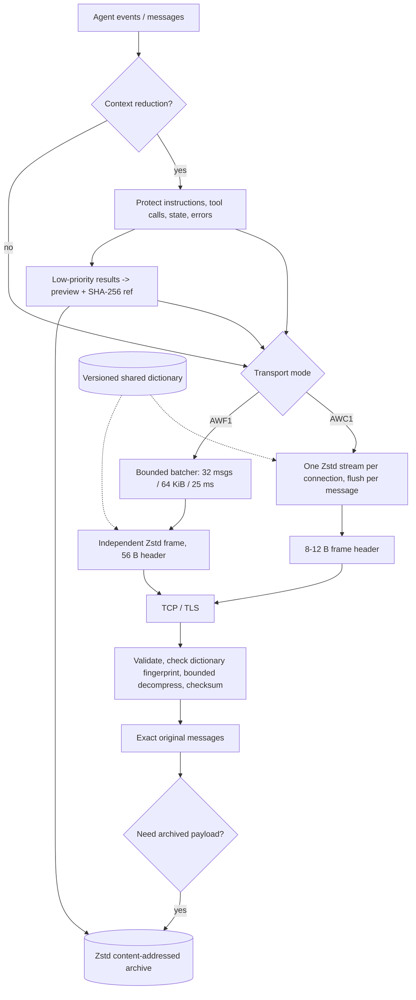
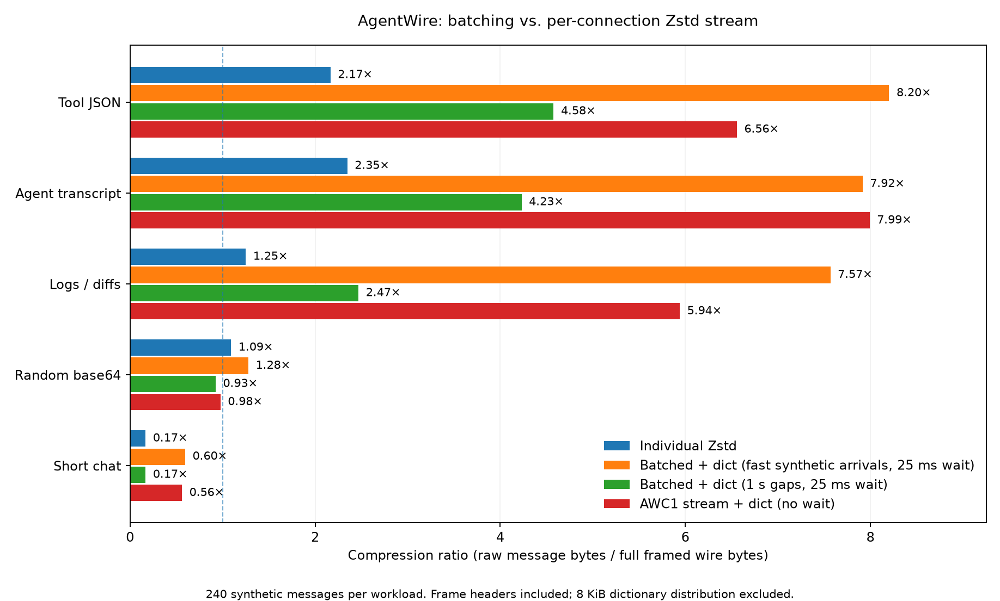

# AgentWire

**Lossless, low-latency compression for AI-agent traffic, plus opt-in, recoverable context reduction.**

AgentWire is an executable proof of concept for moving and storing agent traffic (tool calls, tool results, transcripts, logs, state updates) with far fewer bytes, without changing what the receiving side sees. It is pure Python (3.11+) with **zero pip dependencies**. Compression is done by the system's native `libzstd` through `ctypes`.

It has two independent layers that can be combined:

| Layer | What it does | Lossless? |
|---|---|---|
| **Transport** (AWF1 / AWC1) | Frames and compresses streams of opaque binary messages, optionally with a shared, versioned Zstd dictionary, and reconstructs the *exact* original bytes, IDs, kinds and order on the other side. | **Yes, byte-exact** |
| **Context reducer** | Shrinks an agent's active context by replacing explicitly low-priority tool results with a short preview plus a SHA-256 reference. The full payload goes to a compressed, content-addressed archive and can be restored on demand. | Lossy in the prompt, **exactly recoverable** from the archive |

> **Status:** engineering proof of concept. It has no authentication, TLS, handshake, retries or durable delivery. See [Limitations](#design-decisions-and-limitations) and the [roadmap](ARCHITECTURE.md#practical-production-roadmap).

---

## Contents

- [Headline results](#headline-results)
- [How it works](#how-it-works)
  - [AWF1: batched frames](#awf1-batched-independent-frames)
  - [AWC1: per-connection stream](#awc1-one-zstd-stream-per-connection-context-takeover)
  - [Shared dictionaries](#shared-dictionaries)
  - [Context reducer](#context-reducer)
- [Which mode should I use?](#which-mode-should-i-use)
- [Install](#install)
- [Quick start](#quick-start)
- [CLI reference](#cli-reference)
- [Python API](#python-api)
- [Benchmarks](#benchmarks)
- [Project layout](#project-layout)
- [Testing and reproducing results](#testing-and-reproducing-results)
- [Design decisions and limitations](#design-decisions-and-limitations)
- [Further reading](#further-reading)

---

## Headline results

**Real agent sessions.** 198 held-out Claude Code and Codex sessions (107K messages, 458 MiB) were replayed at their recorded timestamps, and every frame was decoded back byte-for-byte:

| Mode | Claude Code | Codex | Added latency |
|---|---:|---:|---:|
| AWF1, one frame per message | 2.28× | 3.49× | 0 ms |
| AWF1 + dictionary, one frame per message | 3.14× | 4.17× | 0 ms |
| AWF1 + dictionary, 25 ms batches | 3.53× | 4.62× | 25 ms (median) |
| **AWC1 stream + dictionary, 1 MiB window** | **6.24×** | **6.03×** | **0 ms** |
| **AWC1 stream + dictionary, 8 MiB window** | **6.42×** | **6.75×** | **0 ms** |
| *Offline reference: whole session file in one Zstd frame* | *6.55×* | *6.94×* | *n/a* |

**The takeaway:** on real traffic, the AWC1 stream is 1.3–1.8× smaller on the wire than batching, adds no delay, and gets within 2–3% of compressing each finished session in one go. Batching barely helps in practice. Real agents emit messages seconds apart, so a 25 ms window averages only 1.8–2.8 messages. Details are in [Benchmarks](#benchmarks).

---

## How it works



Both transport modes treat payloads as **opaque bytes**. They never parse, rewrite or reorder what you send. A missing or wrong dictionary, a corrupt frame, an oversized frame or a sequence gap always **fails closed** with an exception. The decoder never returns guessed data.

### AWF1: batched, independent frames

Messages are collected by `BoundedBatcher` until one of three limits is hit: **32 messages, 64 KiB, or 25 ms** (all configurable). The batch is then encoded as one record body and compressed into a self-contained Zstd frame. Each frame carries a 56-byte header with a sequence number, the dictionary version and fingerprint, sizes, and a SHA-256 prefix of the uncompressed body. If compression doesn't save bytes, the frame is sent raw.

- ✅ Every frame decodes on its own, so it suits storage, fan-out and replay.
- ✅ Best ratio when messages really arrive in fast bursts.
- ❌ Has to *wait* to collect history, and the 56-byte header is expensive for small messages.

### AWC1: one Zstd stream per connection (context takeover)

AWC1 keeps **one Zstd compression stream open for the whole connection** and flushes it after every message (`ZSTD_e_flush`). Each message goes out immediately, but its matches can point at *anything sent earlier on that connection* (within the window) and at the shared dictionary. It works like WebSocket `permessage-deflate` with context takeover.

```
"AWC1" | RESET(24 B: dictionary version + fingerprint, window_log) | DATA | DATA | ...
DATA = 0x00 | count | original_len | payload_len | crc32 | zstd-flushed payload
```

- ✅ No added latency, an 8–12 byte header per frame, and the best ratio on real traffic.
- ✅ The receiver caps the window (`max_window_log`), so a peer can't make it hold unbounded memory.
- ❌ Each connection holds compressor and decompressor state. Measured at level 3: about **2.1 MiB + 1.5 MiB** at the default 1 MiB window, and 9.1 + 8.5 MiB at 8 MiB.
- ❌ Frames decode only in order. Any error poisons the session (`SessionPoisoned`), and recovery means reconnecting with empty history.
- ❌ There is no raw fallback, so incompressible data can expand slightly (about 0.98×).

The full wire format and failure rules are in [PROTOCOL.md](PROTOCOL.md).

### Shared dictionaries

A Zstd dictionary is a compact sample of "typical" content: JSON keys, tool names, log prefixes. It gives the compressor history before the first byte of a connection.

- **Training** is a single call to libzstd's own trainer, `ZDICT_trainFromBuffer` (the fastCover algorithm), over a set of sample messages. `python3 -m agentwire train` does this from a JSONL file. It is deterministic: the same samples and the same libzstd version give byte-identical output.
- **Versioning:** the caller assigns each dictionary an immutable `u32` version through `DictionaryRegistry.register(version, bytes)`. Every frame (AWF1) or stream RESET (AWC1) carries the version plus a SHA-256 fingerprint, and the receiver refuses anything that doesn't match exactly.
- **Rotation:** load the new dictionary on receivers first, then call `BoundedBatcher.rotate(v)` or `StreamEncoder.rotate(v)` on senders. Keep old versions as long as any stored frames need them.
- **Retraining is manual.** There is no scheduler or drift detection. On real traffic, the AWC1 stream's own history matters much more than the dictionary: it adds only 0–4% on top of the stream. Dictionaries matter most for AWF1 and for the first messages of a connection.

### Context reducer

The reducer is opt-in and deterministic, and it never touches protected events.

- **Always kept intact:** instructions, user messages, tool calls and their arguments, state patches and snapshots, final answers, pinned events, and errors.
- **Eligible for replacement:** only events with `kind` of `tool_result` or `observation`, **and** `importance="low"`, **and** a successful status, **and** not pinned. These may be replaced with an `agentwire.observation_ref.v1` summary (preview, size, top-level keys, SHA-256).
- **Archive:** the full canonical JSON goes to a Zstd-compressed, content-addressed archive (AWB1 format) *before* the summary is emitted. `rehydrate()` restores the exact JSON values and verifies the hash.
- **Budget:** if the byte budget can't be met without touching protected events, the reducer raises `BudgetExceeded` rather than silently dropping anything.

---

## Which mode should I use?

| Situation | Use |
|---|---|
| Interactive agent or tool connection, one session per connection | **AWC1 stream** |
| Long sessions with lots of repetition (big tool outputs, re-sent context) | **AWC1 with `window_log=23`**, if 9 MiB per side per connection is acceptable |
| Gateway multiplexing many busy sessions, or real bursts with 25 ms of slack | AWF1 batches |
| Frames must be stored, fanned out or replayed independently | AWF1 |
| Log or trace shipping that can wait 250–1000 ms | AWF1 with larger batches |
| Context window too large and you can label low-value tool results | Context reducer (either transport) |

---

## Install

Requirements:

- Python **3.11+**
- The system **libzstd** shared library (`brew install zstd` on macOS, `apt install libzstd1` on Debian/Ubuntu)
- `pytest` for the test suite, optional (`pip install -r requirements-dev.txt`)
- `matplotlib` and `numpy` to redraw the chart, optional

```bash
git clone https://github.com/aperiodic-io/agentwire.git
cd agentwire
python3 -m agentwire demo        # no install needed
pip install -e .                 # optional: provides the `agentwire` command
```

---

## Quick start

```bash
python3 -m agentwire demo                  # in-memory transport + context round trip
python3 -m agentwire tcp-demo              # AWF1 batches over loopback TCP
python3 -m agentwire tcp-demo --stream     # AWC1 stream over loopback TCP
python3 -m agentwire pipeline-demo         # context reduction -> TCP -> archive restore
python3 -m agentwire bench                 # synthetic benchmark -> results/RESULTS.md
python3 -m agentwire bench-local           # benchmark on your own Claude Code / Codex logs
python3 -m pytest -q                       # 69 tests
```

Lossless pack and unpack of a JSONL file, in both modes:

```bash
# AWF1 batches
python3 -m agentwire pack   --input examples/tool-output.jsonl --output /tmp/a.awf \
                            --dictionary examples/agent-dict-v1.zdict
python3 -m agentwire unpack --input /tmp/a.awf --output /tmp/a.jsonl \
                            --dictionary examples/agent-dict-v1.zdict
cmp examples/tool-output.jsonl /tmp/a.jsonl

# AWC1 stream (unpack detects the format from the magic bytes)
python3 -m agentwire pack --stream --input examples/tool-output.jsonl --output /tmp/a.awc \
                          --dictionary examples/agent-dict-v1.zdict
python3 -m agentwire unpack --input /tmp/a.awc --output /tmp/b.jsonl \
                            --dictionary examples/agent-dict-v1.zdict
cmp examples/tool-output.jsonl /tmp/b.jsonl
```

Context reduction and restoration:

```bash
python3 -m agentwire reduce  --input examples/events.jsonl --output /tmp/ctx.json \
                             --archive-dir /tmp/archive --budget-bytes 13000
python3 -m agentwire restore --input /tmp/ctx.json --output /tmp/restored.jsonl \
                             --archive-dir /tmp/archive
```

---

## CLI reference

`python3 -m agentwire <command>`, or `agentwire <command>` after `pip install -e .`

| Command | Purpose | Key options |
|---|---|---|
| `demo` | In-memory end-to-end check of transport and context | |
| `tcp-demo` | Real loopback TCP sender and receiver with ACK | `--stream` (AWC1) |
| `pipeline-demo` | Context reduction, then TCP, then archive rehydration | |
| `pack` | Frame each line of a file losslessly | `--input`, `--output`, `--dictionary`, `--dictionary-version` (default 1), `--stream`, `--window-log` (20), `--batch-messages` (32), `--batch-bytes` (65536), `--delay-ms` (25), `--interval-ms` (2) |
| `unpack` | Decode AWF1 or AWC1 back to the original bytes | `--input`, `--output`, `--dictionary`, `--dictionary-version`, `--window-log` (largest window accepted) |
| `train` | Train a Zstd dictionary from JSONL samples | `--input`, `--output`, `--size` (8192) |
| `reduce` | Condense low-priority observations to a byte budget | `--input`, `--output`, `--archive-dir`, `--budget-bytes`, `--preview-chars` (96) |
| `restore` | Rehydrate a reduced context from the archive | `--input`, `--output`, `--archive-dir` |
| `bench` | Synthetic benchmark (5 workloads, 11 variants) | `--output-dir` (results), `--messages` (240), `--repeats` (2) |
| `bench-local` | Benchmark on real local agent logs | `--output-dir` (results/local), `--claude-dir`, `--codex-dir` (`''` skips a source), `--train-fraction` (0.6), `--dict-size` (65536), `--max-test-sessions`, `--exclude-active-minutes` (15), `--no-verify`, `--save-dictionary-dir` |

---

## Python API

### Dictionaries

```python
from pathlib import Path
from agentwire import DictionaryRegistry, train_dictionary

samples = Path("examples/training.jsonl").read_bytes().splitlines(keepends=True)
registry = DictionaryRegistry()
registry.register(1, train_dictionary(samples, capacity=8192))   # immutable version 1
print(registry.manifest())   # [{'version': 1, 'bytes': 8192, 'sha256': '...'}]
```

### AWC1 stream (zero-delay)

```python
from agentwire import Message, StreamEncoder, StreamSessionDecoder

enc = StreamEncoder(registry, dictionary_version=1, window_log=20)   # one per connection
dec = StreamSessionDecoder(registry, max_window_log=20)              # one per connection

for i, payload in enumerate([b'{"tool":"search","ok":true}', b'{"tool":"fetch","ok":true}']):
    wire = enc.encode([Message(i, payload, kind=1)])   # write these bytes immediately
    assert dec.feed(wire) == [Message(i, payload, kind=1)]

enc.rotate(1)   # optional: RESET (new dictionary, or drop history); sent with the next encode()
dec.finish(); enc.close(); dec.close()
```

`feed()` accepts any fragmentation of the byte stream: one byte at a time, or many frames at once.

### AWF1 batches

```python
from agentwire import BoundedBatcher, FrameCodec, Message, StreamDecoder

codec = FrameCodec(registry)
batcher = BoundedBatcher(codec, dictionary_version=1,
                         max_messages=32, max_batch_bytes=65536, max_delay_ms=25)
frames = []
for t, msg in enumerate([Message(1, b"alpha"), Message(2, b"beta")]):
    frames += batcher.add(msg, now_ms=t)   # returns frames that became ready
frames += batcher.poll(now_ms=100)         # deadline flush: YOU must call poll()
if (last := batcher.flush()) is not None:
    frames.append(last)

decoder = StreamDecoder(codec)
assert decoder.feed(b"".join(frames)) == [Message(1, b"alpha"), Message(2, b"beta")]
decoder.finish()
```

### Async TCP

```python
import asyncio
from agentwire import StreamEncoder, StreamSessionDecoder, FrameCodec
from agentwire.asyncio_transport import (AsyncStreamSender, AsyncBatchedSender,
                                         AsyncFramedReceiver)

async def send(writer, messages):
    async with AsyncStreamSender(writer, StreamEncoder(registry, dictionary_version=1)) as s:
        for m in messages:
            await s.send(m)            # compressed, written and drained immediately
    # AWF1 instead: AsyncBatchedSender(writer, FrameCodec(registry), dictionary_version=1)

async def receive(reader):
    rx = AsyncFramedReceiver(reader, decoder=StreamSessionDecoder(registry))
    # AWF1 instead: AsyncFramedReceiver(reader, FrameCodec(registry))
    while (m := await rx.recv()) is not None:
        print(m.id, len(m.payload))
```

`tcp_roundtrip_demo()` in `agentwire/asyncio_transport.py` is a complete runnable example.

### Context reducer

```python
from agentwire import AgentEvent, ContentAddressedStore, ContextReducer, rehydrate

events = [
    AgentEvent("sys", "system", "instruction", "Be careful.", "critical"),
    AgentEvent("call", "assistant", "tool_call", {"name": "logs", "arguments": {"n": 500}}, "critical"),
    AgentEvent("obs", "tool", "tool_result", {"status": 200, "rows": ["ok"] * 500}, "low"),
]
archive = ContentAddressedStore("/tmp/agentwire-archive")
result = ContextReducer(archive, preview_chars=96).reduce(events, budget_bytes=1500)
print(result.original_bytes, "->", result.context_bytes, "bytes;", result.condensed_count, "condensed")
assert rehydrate(result.events, archive) == events   # exact JSON values come back
```

Event schema, one JSON object per line in CLI files:

```json
{"id":"call-1","role":"assistant","kind":"tool_call","payload":{"name":"search","arguments":{"query":"logs"}},"importance":"critical","pinned":false}
```

`kind` is one of `instruction`, `message`, `tool_call`, `tool_result`, `observation`, `state_patch`, `state_snapshot` or `final`. `importance` is one of `low`, `normal` (the default) or `critical`.

---

## Benchmarks

The ratio is original message payload bytes divided by full wire bytes, **including all headers and record metadata**. One-time dictionary distribution is excluded and reported separately in the CSV.

### Synthetic workloads (`python3 -m agentwire bench`)

240 deterministic synthetic messages per workload. The "fast arrivals" column uses the fixtures' 1–5 ms message gaps. The "1 s gaps" column replays the same messages one second apart, closer to a real single agent.

| Workload | AWF1 one frame + dict | AWF1 batch + dict, fast arrivals | AWF1 batch + dict, 1 s gaps | **AWC1 stream + dict** |
|---|---:|---:|---:|---:|
| Repetitive tool JSON | 4.58× | **8.20×** | 4.58× | 6.56× |
| Mixed agent transcripts | 4.23× | 7.92× | 4.23× | **7.99×** |
| Logs and code diffs | 2.47× | **7.57×** | 2.47× | 5.94× |
| Random base64 | 0.93× | **1.28×** | 0.93× | 0.98× |
| Tiny chat messages | 0.17× | **0.60×** | 0.17× | 0.56× |



Fast batching wins only when messages really arrive milliseconds apart. Tiny messages expand in every mode, because record metadata, checksum and block headers outweigh a few bytes of payload. All 55 measurements are in [results/RESULTS.md](results/RESULTS.md) and [results/bench.csv](results/bench.csv).

### Real local sessions (`python3 -m agentwire bench-local`)

`bench-local` measures AgentWire on your own logs, `~/.claude/projects/**/*.jsonl` and `~/.codex/sessions/**/*.jsonl`:

- **Replay:** each session file is one connection, and each JSONL line is one message (exact bytes) sent at its recorded timestamp.
- **No leakage:** sessions are ordered by start time, and each corpus's dictionary (64 KiB) is trained only on the **oldest 60%**. Every number is measured on the newer 40%.
- **Verification:** every frame is decoded and compared byte-for-byte.
- **Privacy:** it writes only aggregate numbers. Trained dictionaries contain transcript fragments, so they stay in memory unless you pass `--save-dictionary-dir`.
- **Active logs:** logs modified in the last 15 minutes are skipped, so a session still in progress isn't measured.

Results from one machine (46 Claude Code and 152 Codex test sessions, 60 s runtime):

| Variant | Claude Code | Codex | Messages per frame | Added wait (p50) |
|---|---:|---:|---:|---:|
| AWF1 one frame | 2.28× | 3.49× | 1.0 | 0 ms |
| AWF1 one frame + dict | 3.14× | 4.17× | 1.0 | 0 ms |
| AWF1 batch | 2.67× | 3.94× | 2.8 / 1.8 | 25 ms |
| AWF1 batch + dict | 3.53× | 4.62× | 2.8 / 1.8 | 25 ms |
| AWC1 stream | 6.02× | 6.01× | 1.0 | 0 ms |
| AWC1 stream + dict | 6.24× | 6.03× | 1.0 | 0 ms |
| AWC1 stream + dict, 8 MiB window | 6.42× | 6.75× | 1.0 | 0 ms |
| Whole file, offline | 6.55× | 6.94× | n/a | n/a |

What this shows:

1. **History beats batching.** The stream mode remembers everything sent on the connection, which is worth far more than gathering a handful of messages per 25 ms.
2. **Dictionaries matter less once you stream** (+0–4%), but they still help AWF1 a lot (+17–38%).
3. **The window matters for long sessions.** Codex sessions repeat content more than 1 MiB back, and the 8 MiB window adds 12%.
4. Session logs **approximate** wire traffic. They are what an agent records, not exactly what it sends to an API.

The full report from that run is in [results/local/RESULTS.md](results/local/RESULTS.md).

---

## Project layout

```
agentwire/
  zstd.py               ctypes bindings: one-shot and streaming Zstd, dictionary training
  transport.py          AWF1 frame codec, BoundedBatcher, StreamDecoder, DictionaryRegistry
  stream.py             AWC1 StreamEncoder / StreamSessionDecoder
  asyncio_transport.py  AsyncBatchedSender, AsyncStreamSender, AsyncFramedReceiver, TCP demo
  context.py            AgentEvent, ContextReducer, ContentAddressedStore (AWB1), rehydrate
  benchmark.py          synthetic benchmark
  localbench.py         real-session benchmark (bench-local)
  fixtures.py           deterministic synthetic workloads
  __main__.py           CLI
tests/                  69 tests: transport, stream, context, CLI, local benchmark
examples/               sample JSONL inputs, an 8 KiB example dictionary + manifest
results/                benchmark outputs, chart, example archives, build manifest
PROTOCOL.md             AWF1, AWC1 and AWB1 wire and archive formats
ARCHITECTURE.md         invariants, data flow, operational model, production roadmap
plot_results.py         regenerates results/compression-ratios.png
reproduce.sh            runs every verification gate end to end
```

---

## Testing and reproducing results

```bash
pip install -r requirements-dev.txt
python3 -m pytest -q            # 69 tests, about 1.5 s
./reproduce.sh                  # tests, demos, benchmark, chart, pack/unpack checks (needs matplotlib)
```

The tests cover byte-exact round trips of arbitrary binary data, one-byte fragmentation, dictionary rotation, missing or mismatched dictionaries, frame corruption, truncation, non-canonical varints, size limits enforced before decompression, sequence gaps, reordering, session poisoning, AWC1 window limits, real loopback TCP, CLI round trips, context protection and rehydration, and the local benchmark on synthetic session files. The test suite never reads real user logs.

The last verified run is recorded in [results/build-manifest.json](results/build-manifest.json): macOS arm64, Python 3.14, libzstd 1.5.7, 69 tests passing.

---

## Design decisions and limitations

- **Fail closed.** Unknown flags or versions, dictionary mismatches, bad checksums, oversized frames and non-canonical varints all raise. Size limits are checked *before* decompression, and output is capped to the declared size.
- **Integrity, not security.** The SHA-256 prefix (AWF1) and CRC32 (AWC1) only catch accidental corruption. Run inside TLS or add a MAC/AEAD.
- **Delivery.** AWF1 sequence numbers detect gaps and replays within one connection. There is no durable ACK log, resume or exactly-once delivery, and the TCP demo's ACK is illustrative only.
- **AWC1 state.** It uses memory per connection, decodes only in order, and a lost connection loses its history. Negotiating mode, window and dictionary in a HELLO/ACK handshake is on the roadmap.
- **Dictionaries** are pre-provisioned out of band. There is no remote fetch from untrusted frames, and no automatic retraining.
- **Performance.** Python orchestration plus ctypes. AWF1 creates a fresh Zstd context per frame and reloads the dictionary each time, which is slow with a 64 KiB dictionary. Production should use Rust or Go with pooled contexts and prepared dictionaries.
- **Context reduction** relies on *your* `importance` labels. It is a deterministic extractive truncator with no semantic check, and fewer bytes doesn't necessarily mean proportionally fewer tokens. Evaluate on task success.
- **Archive.** The local filesystem stands in for an object store. There is no encryption, access control or lifecycle management.

---

## Further reading

- [PROTOCOL.md](PROTOCOL.md): byte-level AWF1, AWC1 and AWB1 specs and failure conditions
- [ARCHITECTURE.md](ARCHITECTURE.md): invariants, data flow, operational safety model, production roadmap
- [results/RESULTS.md](results/RESULTS.md): every synthetic measurement
- [results/local/RESULTS.md](results/local/RESULTS.md): real-session benchmark report
